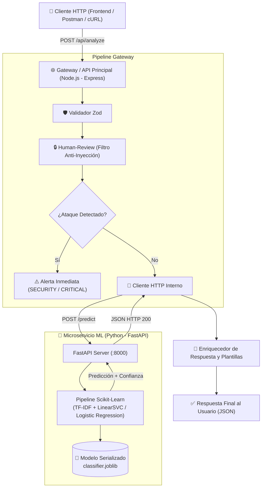
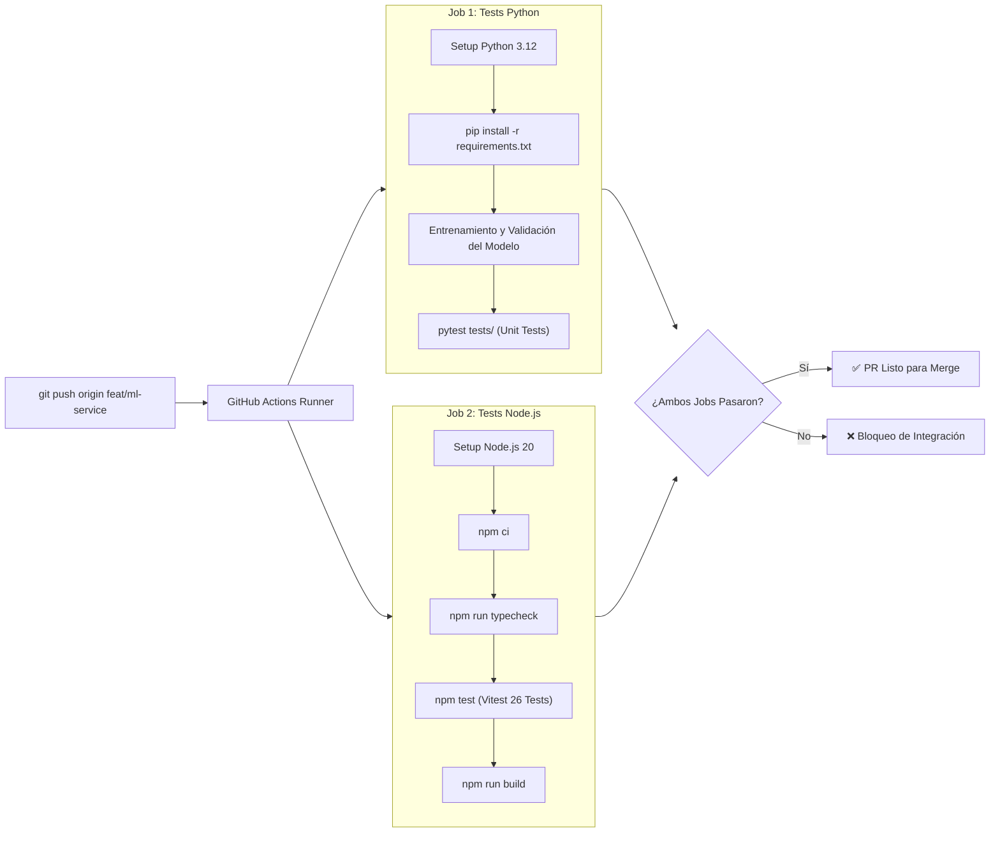
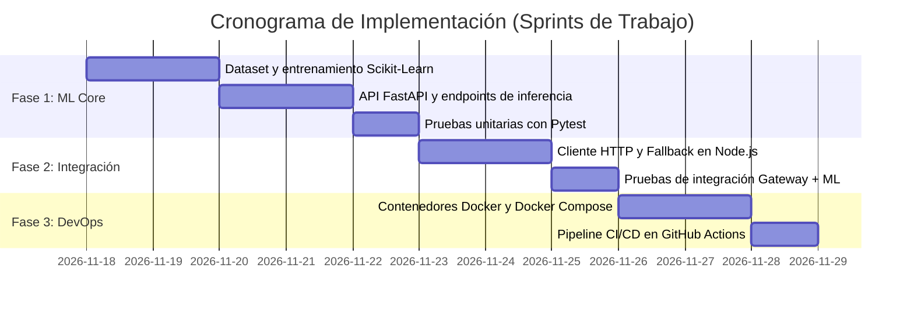

# 🚀 Plan de Arquitectura y Migración a Microservicio de Machine Learning

Este documento detalla la propuesta técnica para evolucionar **AI Support Engine** hacia una arquitectura desacoplada basada en microservicios, reemplazando la dependencia de APIs externas con un **modelo de Machine Learning 100% local, gratuito y de alto rendimiento**, respaldado por pruebas unitarias automatizadas y un pipeline de **CI/CD con GitHub Actions**.

---

## 📌 Tabla de Contenidos
1. [Objetivos y Beneficios](#1-objetivos-y-beneficios)
2. [Arquitectura del Sistema](#2-arquitectura-del-sistema)
3. [Estructura del Proyecto (Monorepo)](#3-estructura-del-proyecto-monorepo)
4. [Microservicio de Machine Learning (Python)](#4-microservicio-de-machine-learning-python)
5. [Integración en la API Principal (Node.js)](#5-integración-en-la-api-principal-nodejs)
6. [Estrategia de Pruebas Unitarias](#6-estrategia-de-pruebas-unitarias)
7. [Pipeline de Integración y Despliegue Continuo (CI/CD)](#7-pipeline-de-integración-y-despliegue-continuo-cicd)
8. [Orquestación con Docker Compose](#8-orquestación-con-docker-compose)
9. [Cronograma de Implementación](#9-cronograma-de-implementación)

---

## 1. Objetivos y Beneficios

| Desafío Actual | Solución con Microservicio ML |
|---|---|
| **Costos y Cuotas de API:** Límites de 5 peticiones/minuto en Google Gemini Free Tier. | **Cero costos operativos:** El modelo corre en local con hardware estándar (CPU). Sin límite de peticiones. |
| **Latencia de Red:** Las llamadas a proveedores de LLM toman entre 1,000 y 3,000 ms. | **Inferencia ultrarrápida:** Clasificación en **menos de 5 milisegundos**. |
| **Privacidad de Datos:** Los tickets viajan a servidores de terceros en la nube. | **Privacidad total (On-Premise):** La información sensible de soporte nunca sale de la red local. |
| **Monolito de Backend:** Node.js asume todas las responsabilidades. | **Desacoplamiento:** Microservicio especializado que escala de forma independiente. |

---

## 2. Arquitectura del Sistema



---

## 3. Estructura del Proyecto (Monorepo)

```text
ai-support-engine/
├── .github/
│   └── workflows/
│       └── ci-cd.yml               # Pipeline automatizado de GitHub Actions
├── docker-compose.yml              # Orquestación de contenedores (Node + Python)
├── README.md                       # Documentación principal del reto escolar
├── PLAN_MICROSERVICIO_ML.md        # Este documento de arquitectura
│
├── src/                            # API Gateway / Backend Principal (Node.js)
│   ├── controllers/
│   │   └── analyze.controller.ts   # Orquestador con soporte de fallback
│   ├── middleware/
│   │   └── validator.ts            # Validación de entradas con Zod
│   ├── security/
│   │   └── human-review.ts         # Reglas de intervención humana y antievasión
│   ├── services/
│   │   └── ml-client.service.ts    # Cliente HTTP con Circuit Breaker hacia Python
│   ├── types/
│   │   └── index.ts                # Contratos TypeScript inmutables
│   └── app.ts                      # Servidor Express (:3000)
│
└── ml-service/                     # NUEVO: Microservicio de Machine Learning (Python)
    ├── model/
    │   ├── train.py                # Script de entrenamiento y evaluación
    │   ├── dataset_train.csv       # Corpus de entrenamiento etiquetado
    │   └── classifier.joblib       # Modelo compilado y serializado (< 2 MB)
    ├── src/
    │   ├── app.py                  # API REST construida con FastAPI (:8000)
    │   ├── classifier.py           # Clase singleton que carga y consulta el modelo
    │   └── schemas.py              # Esquemas de validación de datos con Pydantic
    ├── tests/
    │   ├── test_model.py           # Pruebas de precisión del algoritmo
    │   └── test_api.py             # Pruebas de endpoints con FastAPI TestClient
    ├── Dockerfile                  # Imagen ligera basada en python:3.12-slim
    └── requirements.txt            # Dependencias fijadas (fastapi, uvicorn, scikit-learn, etc.)
```

---

## 4. Microservicio de Machine Learning (Python)

### 4.1 Tecnologías Seleccionadas
- **Python 3.12-slim:** Entorno de ejecución ligero y moderno.
- **FastAPI + Uvicorn:** Framework asíncrono de alto rendimiento con validación automática y documentación OpenAPI (`/docs`).
- **Scikit-Learn:** `TfidfVectorizer` (unigramas y bigramas) + `LinearSVC` / `LogisticRegression` para clasificación multiclase.
- **Joblib:** Serialización y carga en memoria de bajo consumo (< 60 MB RAM).

### 4.2 Esquema del Contrato de Entrada y Salida (API Python)

#### Petición (`POST /predict`):
```json
{
  "text": "No puedo ingresar a mi panel de control con mi contraseña"
}
```

#### Respuesta:
```json
{
  "category": "ACCESS",
  "priority": "MEDIUM",
  "confidence": 0.94,
  "execution_time_ms": 3.2
}
```

---

## 5. Integración en la API Principal (Node.js)

### 5.1 Cliente HTTP Resiliente (`src/services/ml-client.service.ts`)
- Se conecta vía red interna a `http://ml-service:8000/predict` (en Docker) o `http://localhost:8000/predict` (en local).
- **Mecanismo de Circuit Breaker y Fallback Seguro:**
  Si el microservicio de Python sufre una caída o sobrecarga, el controlador captura la excepción y conmuta de forma transparente al motor simbólico tradicional (`traditional.ts`), garantizando **disponibilidad del 100% (High Availability)**.

---

## 6. Estrategia de Pruebas Unitarias

El proyecto contará con **dos suites de pruebas independientes** ejecutadas en paralelo:

### Suite 1: Microservicio Python (`pytest`)
1. **`test_model_accuracy`:** Valida que el modelo supere el 90% de precisión en un conjunto de validación independiente.
2. **`test_api_predict_success`:** Valida que peticiones válidas devuelvan HTTP 200 con la estructura JSON correcta (`category`, `priority`, `confidence`).
3. **`test_api_empty_payload`:** Valida que textos vacíos o inválidos sean rechazados con HTTP 422.
4. **`test_inference_latency`:** Valida que el tiempo de inferencia individual no exceda los 25 ms.

### Suite 2: API Node.js (`vitest`)
1. **26 pruebas unitarias existentes:** Motores tradicionales, generativos, esquemas Zod y seguridad.
2. **`test_ml_client_integration`:** Valida la serialización y deserialización de llamadas hacia el microservicio.
3. **`test_ml_fallback_on_failure`:** Simula una caída del servicio Python y verifica que Node.js responda exitosamente mediante el motor de respaldo tradicional sin arrojar errores al usuario.

---

## 7. Pipeline de Integración y Despliegue Continuo (CI/CD)

Flujo automatizado configurado en `.github/workflows/ci-cd.yml` activado ante cada `push` o `pull_request`:



### Configuración del Workflow (`.github/workflows/ci-cd.yml`)
- **Etapa Python:** Instala dependencias, valida la compilación del modelo y ejecuta `pytest`.
- **Etapa Node.js:** Verifica tipos con `tsc --noEmit`, ejecuta la suite `vitest` y compila TypeScript a producción en `dist/`.
- **Criterio de Aprobación:** Ambos trabajos deben completarse con éxito en verde para permitir la integración a `main`.

---

## 8. Orquestación con Docker Compose

Un solo comando para inicializar todo el stack en cualquier entorno:

```bash
docker compose up --build
```

### `docker-compose.yml` (Definición conceptual):
- **Servicio `ml-service`:** Expone el puerto `8000`, inicializa el servidor Uvicorn con el modelo precargado en memoria.
- **Servicio `api-gateway`:** Expone el puerto `3000`, depende de que `ml-service` esté en estado saludable (*healthcheck*), y consume la inferencia localmente.

---

## 9. Cronograma de Implementación



---

> [!TIP]
> **Conclusión de Arquitectura:**
> Esta propuesta transforma el proyecto en una solución de **nivel empresarial**: económica (costo cero), privada (on-premise), tolerante a fallos (arquitectura en capas con *fallback*) y con estándares profesionales de ingeniería de software (CI/CD y cobertura de pruebas automatizadas).
